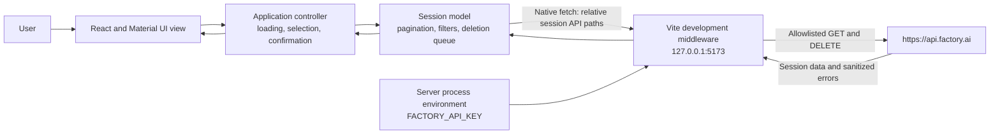
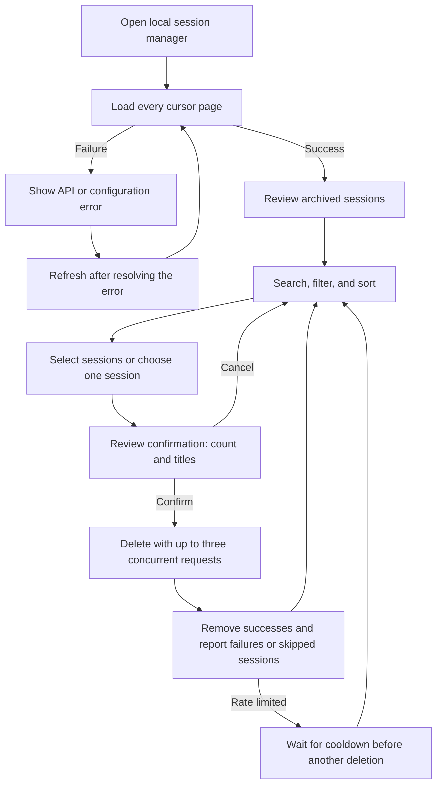

# Architecture

This document derives from the immutable kernel. The app runs on one trusted local machine and has no database or separate backend framework. Material UI defaults implement the kernel's light, plain design.

The model in `src/models/sessions.ts` owns Factory response validation, pagination, filtering, sorting, and the bounded deletion queue. The application controller in `src/controllers/SessionController.ts` owns the currently loaded sessions, selected IDs, loading state, confirmation snapshot, cooldown, and results. React subscribes to that controller with `useSyncExternalStore`; `src/App.tsx` renders those values and exposes explicit user actions. These are small modules and functions rather than a state-management framework or custom-hook hierarchy.

The Vite plugin installs local development middleware that forwards requests using native server-side fetch. It reads the key only from `process.env.FACTORY_API_KEY`. It restricts requests to session listing, session details, and session deletion, replaces browser-supplied authorization, and does not expose configuration to the client. It must reject unsupported methods and paths rather than become a general-purpose forwarding proxy. Missing configuration and upstream failures produce readable errors without returning credentials.

## API contract

The [Factory sessions documentation](https://docs.factory.com/api-reference/sessions), reviewed for this implementation on 2026-11-07, describes:

- `GET /api/v0/sessions` with `limit` from 1 through 100 and an optional cursor. The response contains `sessions` and `pagination`, including `hasMore` and `nextCursor`.
- Session values including `sessionId`, `title`, `status`, `createdAt`, `updatedAt`, and `messageCount`; archived state comes from `sessionSettings.archivedAt` when present. `createdAt` and `updatedAt` are Unix milliseconds.
- `GET /api/v0/sessions/{sessionId}` for details and `DELETE /api/v0/sessions/{sessionId}` for deletion. HTTP 204 confirms deletion, which remains subject to retention and organization availability.

The app requests pages of 100, deduplicates sessions by ID, and rejects a missing or repeated continuation cursor when more pages are claimed. A refresh replaces the loaded snapshot. Search matches title or ID, the default filter is archived, and sorting uses `updatedAt`.

Deletion uses a snapshot of explicitly confirmed sessions and processes at most three requests concurrently. HTTP 204 removes a session locally. Other results remain failures, including 404; the application does not claim that an unsuccessful request deleted a session. HTTP 429 stops the pending queue and establishes a cooldown from `Retry-After`. HTTP 401 and 403 also stop pending work. Already-started requests settle and are reported individually. No failed DELETE is retried automatically.

## User journey

## Validation boundary

Node tests exercise the model, controller, and local proxy with synthetic data. TypeScript and Vite verify the build. `tests/serve-fixture.ts` supplies a separate browser-test server on `127.0.0.1:5174`; it never loads the real proxy or reads a Factory key. Browser smoke checks cover the rendered interface without an actual account or destructive live API request. Passing mock checks cannot prove Factory account permissions, live organization policy, or retention behavior; those remain upstream API facts. Current evidence is recorded in [VALIDATION/checks.md](VALIDATION/checks.md).
